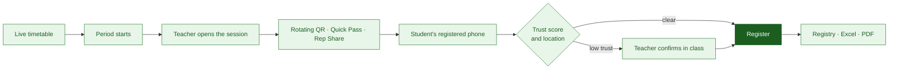

<p align="center">
  
</p>

<p align="center">
  <b>Attendance, timetables and campus records for colleges.</b><br>
  One sign-in for students, teachers, HODs and admins.
</p>

<p align="center">
  
  
  
  
  
  
</p>

<p align="center">
  <a href="#the-new-look">The new look</a> ·
  <a href="#what-muster-does">What Muster does</a> ·
  <a href="#portals">Portals</a> ·
  <a href="#quick-start">Quick start</a> ·
  <a href="#configuration">Configuration</a> ·
  <a href="#deploy-on-railway">Deploy</a>
</p>

---

## Muster in one minute

A teacher opens the period and the class marks itself: by scanning a rotating QR code on the screen or smart board, by typing a 12-character pass, or through the class representative. Students mark only from the phone registered to them, and every mark carries a trust score. Anything that looks wrong goes back to the teacher, who confirms it in the room.

Behind the roll sits the timetable. Coordinators build it in a draft workspace, HODs approve it, and it goes live on a set date. Attendance, substitutions and every teacher's day follow the live timetable automatically.



---

## The new look

Muster has a new face. The sign-in page becomes an open register, the icons and dropdowns are redrawn, and the admin screens use one card system.

<table>
  <tr>
    <th align="left">Area</th>
    <th align="left">What changed</th>
    <th align="left">Status</th>
  </tr>
  <tr>
    <td><b>Sign-in, "Open book"</b></td>
    <td>Two pages of a register. The dark green left page carries the Muster mark and the line <i>Everyone, accounted for.</i> The mint right page holds the form.</td>
    <td>Next release</td>
  </tr>
  <tr>
    <td><b>Location when asked</b></td>
    <td>No location prompt on page load. A row reads <i>Location confirms you're on campus</i> with an <b>Allow</b> button. If the browser already allowed it, Muster checks quietly. If you skip it, it asks when you press Sign in.</td>
    <td>Next release</td>
  </tr>
  <tr>
    <td><b>Plainer messages</b></td>
    <td><i>Username or password is wrong. Try again.</i> A Caps Lock warning under the password, a <i>Welcome back</i> greeting with <i>Not you?</i>, and an offline notice before you try to sign in.</td>
    <td>Next release</td>
  </tr>
  <tr>
    <td><b>One sign-in for everyone</b></td>
    <td>The Student, Teacher, Admin and Smart Board tabs are gone. One form finds the account and opens the right portal. Sign-in went from about 2.5 s to 100–170 ms.</td>
    <td>2.5.0</td>
  </tr>
  <tr>
    <td><b>Re-icon set</b></td>
    <td>105 hand-picked SVG icons in outline and filled styles, served by a <code>&lt;re-icon&gt;</code> web component. Emoji are gone from the interface.</td>
    <td>2.5.0</td>
  </tr>
  <tr>
    <td><b>Searchable dropdowns</b></td>
    <td>Type several words to filter, move with the keyboard, and see green department badges on each option.</td>
    <td>2.5.0</td>
  </tr>
  <tr>
    <td><b>Admin cards</b></td>
    <td>Teacher cards with role colours for HOD, Super Admin and Sudo Admin. Department cards with coverage bars and the HOD in the footer. Executive Roles split into Programme and Supporting lanes.</td>
    <td>2.5.2</td>
  </tr>
  <tr>
    <td><b>Student details</b></td>
    <td>Tabbed view with a full-semester attendance graph, a single Student Actions tab, and animated switchers for gender, admission type and residency.</td>
    <td>2.5.2</td>
  </tr>
</table>

**Palette**

| Token | Hex | Used for |
| --- | --- | --- |
| `--gD` | `#1b5e20` | Left page, primary buttons, headings |
| `--gK` | `#2e7d32` | Labels, active states |
| `--gL` | `#66bb6a` | Field underlines, accents |
| `--gLt` | `#e8f5e9` | Right page, soft surfaces |

The brand files live in [`docs/brand/`](docs/brand): the banner above and the Muster mark, an open register whose two pages form the M, with a tick.

---

## What Muster does

Items marked *beta* work but are still being finished.

### 01 · Taking the roll

- **Rotating QR.** HMAC-signed codes that change every 20 seconds by default, with a 2-second grace window. Shown on the teacher's screen or the classroom smart board, with a countdown ring and a live list of who has checked in.
- **Quick Pass.** A 12-character code that rotates on a timer and can be limited to the campus network.
- **Rep Share.** The teacher hands a period to a class representative. The rep enters the headcount, which must match the number marked present, and the teacher reviews and finalises it.
- **Manual register.** Mark by hand, with period notes and teaching notes.
- **Class-start prompt.** A light 30-second watcher notices when a teacher's class begins and offers to open attendance. Snooze for 5 minutes, or prefill class, subject and period from the *Today's classes* chips.
- **Substitutes.** A teacher covering a period can mark it. Every substitute mark goes into the audit log.
- **Edit lock.** Records lock after a window the college sets, for example 6 hours. Only the teacher who marked a period, or another teacher of that class, can change it.
- **Geofence.** Each room has a point and a radius, picked on a map. With the geofence on, QR marks from outside the radius or with poor GPS accuracy fail.

### 02 · Trust and devices

- **One phone per student**, registered in front of the class advisor. On that phone the student stays signed in for 15 days.
- **Trust score from 0 to 100**, built from seven signals: one device per student in the session, device history, sign-in link and timing, browser match, network match, location and the QR window. It is frozen at the moment of marking, along with a device score and a risk level.
- **Flags** such as shared device, missing device id and browser mismatch expose proxy marking.
- **Teacher review.** Low-trust marks go to the teacher, who confirms the student is in the room or reports that they are not.
- **Penalties are ledger entries,** never silent edits. Every penalty can be disputed and reversed exactly. Device replacement and shared-device cases have their own flows.

### 03 · Timetable studio

- **Development and Production.** Coordinators draft freely with autosave. Production is what attendance runs on.
- **Approval and go-live.** HODs review a visual diff, approve, and the new timetable starts on its effective date. Every publish keeps a snapshot for comparison and rollback.
- **Desktop-grade editor.** Tabs per class, split screen (`Alt+S`), drag and drop, arrow-key navigation and a right-click menu for copy, paste, swap, comment and *find a free teacher*.
- **Live clash checks** for teachers and halls, judged by clock time across two bell schedules, with breaks, labs, combined classes and fixed activities such as Library or Mentoring.
- **Views** for workload, a teacher's week, free rooms, room allocation and the department overview.
- **Excel import** with fuzzy matching of teacher, subject and room names, and a colour-coded preview before anything is saved.
- **Autogen** builds draft timetables within teaching-load limits and lab-room needs. *beta*
- **My Schedule** for every teacher, with holidays, leave, room changes and substitutions applied day by day.

### 04 · Leave, on-duty and substitution

- **Student leave and staff leave,** each switchable on its own.
- **On-duty requests** with event categories, reasons and proof uploads, approved stage by stage.
- **Teacher leave lists the periods it affects** and asks for a substitute for each. Substitutes see a 14-day *My Substitution Duties* tab.
- **Hall shifts.** When an exam takes a hall, the classes in it get a hall-shift request.

### 05 · Calendar, exams and hostel

- **Academic calendar** per year: working days, holidays, half-days, exam and assessment days. College regulations are kept on the Manage page.
- **Exams** with their own attendance.
- **Hostel** attendance and hostel leave.

### 06 · Records and reports

- **Attendance Roster.** A day view per class. Click a period to see each mark with its method, device, network and location, or open a student's full breakdown signal by signal. Every forensic view is itself logged.
- **Attendance Registry.** A spreadsheet-style register with frozen name columns and totals: `P` present, `A` absent, `L` leave, `OD` on duty, `H` holiday. Filter for students below 75%, and switch between a period grid and a day summary.
- **Exports.** Excel with live `COUNTIF` formulas and a legend sheet, A4 landscape PDF with signature strips, and a clean print layout.
- **Export centre** for saved report templates and history. *beta*

### 07 · Running the college

- **Roles with scope.** Sudo Admin for the institution, Super Admin per department, and Sub-Admins with page-level rights that expire. HODs, the Principal, class advisors, timetable coordinators and class representatives each see what their role needs.
- **Page access.** Any portal can be shown, restricted or hidden. Hidden pages are blocked on the server too.
- **Settings hub** for institution details, portals, attendance rules, feature switches, device policy, mail and backups.
- **Bulk import** of departments, teachers, classes, subjects and students, with record-by-record verification, Sudo Admin approval, resumable sessions and a live database rescan.
- **Recycle bin.** Restore a deleted record in one click, with references checked.
- **Backups.** Encrypted backups, optionally copied to Google Drive, and restore from a backup file. *beta*
- **Faculty grievances,** mail notifications by SMTP or Gmail, and a first-run setup wizard.

### 08 · Smart boards and the control room

- **Smart board view.** Full-screen display for wall boards: the class in session, teacher, room and what comes next, the rotating QR, and a campus broadcast banner. Boards pair with a short-lived code and can be refreshed or locked remotely.
- **System controller.** Live memory, CPU, event-loop and uptime gauges; scheduled maintenance windows with a countdown banner; an IP allow-list for on-campus testers; a live session monitor; and a viewer for the encrypted audit log.

---

## Portals

| Page | File | Who uses it |
| --- | --- | --- |
| Sign-in | `index.html` | Everyone |
| Student portal | `student.html` | Students, class representatives |
| Teacher portal | `teacher.html` | Teachers, HODs, advisors |
| Check-in | `attendance.html` | Students marking by QR or Quick Pass |
| Timetable studio | `timetable.html` | Coordinators, HODs |
| Admin | `admin.html` | Admins: people, roles, departments, grievances |
| Manage | `manage.html` | Admins: calendar, working days, regulations |
| Control | `control.html` | Admins: Roster, Registry, data management |
| Controller | `controller.html` | Sudo Admin: system health and maintenance |
| Settings | `settings.html` | Sudo Admin |
| Bulk upload | `bulk.html` | Admins |
| Export | `export.html` | Admins, HODs |
| Hostel | `hostel.html` | Hostel staff |
| Rooms | `rooms.html` | Admins: buildings, rooms, geofences |
| Responsibilities | `responsibilities.html` | Admins |
| Logs | `logs.html` | Admins |
| Smart board | `board.html` | Classroom boards |
| Workspace hub | `selector.html` | Staff choosing or requesting a workspace |
| Maintenance | `maintenance.html` | Shown during maintenance |

---

## Under the hood

| Layer | Built with |
| --- | --- |
| Server | Node.js 18+, Express 4 |
| Data | MongoDB with Mongoose 9 |
| Real time | WebSockets (`ws`) for smart boards and timetable sync |
| Sign-in | JSON Web Tokens, bcrypt (`@node-rs/bcrypt`) |
| Protection | `helmet`, `express-rate-limit`, AES-256-GCM for audit logs and QR data |
| Files | `exceljs`, `pdfkit`, `qrcode`, `multer` |
| Mail and storage | `nodemailer`, Gmail and Google Drive APIs |
| Frontend | Plain HTML, CSS and JavaScript, no framework |
| Hosting | Railway (Nixpacks) |

```
muster/
├── server.js        app entry
├── config/          settings, database connection, first-run seeding
├── middleware/      sign-in, page access, scope
├── models/          Mongoose schemas
├── routes/          REST API
├── services/        timetable engine, exports, backups, sockets
├── jobs/            scheduled work: go-live, day start, version close
├── utils/           crypto, mail, rate limits, device trust
├── scripts/         setup CLI and one-off migrations
└── public/          the 19 pages, with css/ and js/
```

---

## Quick start

**You need** Node.js 18 or later and a MongoDB database (a free MongoDB Atlas cluster works).

```bash
git clone https://github.com/x-rag-x/EAMS-Project.git muster
cd muster
npm install
```

Create a `.env` file in the project root:

```env
# required: the server will not start without these five
MONGO_URI=mongodb+srv://<user>:<password>@<cluster>.mongodb.net/
JWT_SECRET=<random string>
LOG_ENCRYPTION_KEY=<random string>
QRID_ENCRYPTION_KEY=<random string>
SID_ENCRYPTION_KEY=<random string>

# recommended
DB_NAME=muster
adminPassword=<password for the first Sudo Admin>
NODE_ENV=development
PORT=3000
```

Make each secret with `openssl rand -hex 32`, and never commit `.env`.

```bash
npm start
```

Open **http://localhost:3000**.

### First sign-in

1. Sign in as `admin` with the `adminPassword` you set. If you left it out, a built-in default is used and Muster flags it.
2. The setup wizard opens:
   1. Change the Sudo Admin password.
   2. Create the primary department.
   3. Fill in the Sudo Admin profile.
3. Open **Bulk upload** and bring in departments, teachers, classes, subjects and students, in that order.
4. In **Admin › Executive Roles**, appoint HODs, class advisors and timetable coordinators.
5. In **Settings**, enter the institution's details and switch on the features you want.

### Scripts

| Command | What it does |
| --- | --- |
| `npm start` | Start the server |
| `npm run dev` | Same as start |
| `npm run setup` | Database console: add users, departments and classes, seed demo data, delete records |
| `npm run check:xss` | Scan the frontend for unsafe HTML patterns |

---

## Configuration

**Required**

| Variable | Purpose |
| --- | --- |
| `MONGO_URI` | MongoDB connection string |
| `JWT_SECRET` | Signs sign-in tokens |
| `LOG_ENCRYPTION_KEY` | Encrypts audit logs and QR data |
| `QRID_ENCRYPTION_KEY` | Encrypts QR ids |
| `SID_ENCRYPTION_KEY` | Encrypts session ids |

**Server**

| Variable | Default | Purpose |
| --- | --- | --- |
| `DB_NAME` | from the URI | Database name |
| `PORT` | `3000` | HTTP port |
| `NODE_ENV` | `production` | Set `development` for local work |
| `JWT_EXPIRES_IN` | `24h` | Sign-in token lifetime |
| `BCRYPT_ROUNDS` | `10` | Password hashing cost |
| `CORS_ORIGIN` | `http://localhost:5500` | Allowed cross-origin caller |
| `TRUST_PROXY` | on in production | Set `false` if no reverse proxy sits in front |
| `PRODUCTION_DOMAIN` | request host | Domain used in QR links and emails |
| `PORTAL_URL` | none | Sign-in link placed in bulk-import emails |

**Secrets and access**

| Variable | Default | Purpose |
| --- | --- | --- |
| `BOARD_JWT_SECRET` | from `JWT_SECRET` | Signs smart-board tokens |
| `TT_LINK_SECRET` | temporary | Signs timetable share links. Set it, or links break on restart |
| `BACKUP_ENCRYPTION_KEY` | `FIELD_ENCRYPTION_KEY`, then `JWT_SECRET` | Encrypts backups |
| `BOOTSTRAP_ALLOWED_IPS` | none | Comma-separated IPs allowed to run first-run setup |
| `TIMETABLE_PRODUCTION_READ_ONLY` | off | `true` makes the live timetable change only through approved pushes |
| `adminPassword` | built-in | First Sudo Admin password |
| `teacherPassword`, `studentPassword` | none | Test accounts, created only when auto-seed is on |
| `deleteDataPassword`, `exportDataPassword` | none | Extra passwords for deleting or exporting data |

**Mail**

| Variable | Purpose |
| --- | --- |
| `SMTP_HOST`, `SMTP_PORT`, `SMTP_USER`, `SMTP_PASS`, `SMTP_FROM` | SMTP sending |
| `GMAIL_CLIENT_ID`, `GMAIL_CLIENT_SECRET`, `GMAIL_REFRESH_TOKEN`, `GMAIL_SENDER_EMAIL` | Sending through the Gmail API |

**Google Drive**

| Variable | Purpose |
| --- | --- |
| `GDRIVE_CLIENT_ID`, `GDRIVE_CLIENT_SECRET`, `GDRIVE_REFRESH_TOKEN` | Drive access |
| `GDRIVE_BACKUP_FOLDER_ID`, `GDRIVE_BULK_FOLDER_ID` | Folders for backups and uploaded spreadsheets |
| `GOOGLE_SERVICE_ACCOUNT_JSON`, `GOOGLE_SHARED_DRIVE_ID` | Service-account access to a shared drive |

---

## Deploy on Railway

1. Push the project to GitHub, without `.env`.
2. In Railway, choose **New Project › Deploy from GitHub** and pick the repository.
3. Add the five required variables, plus `DB_NAME`, `adminPassword` and `PRODUCTION_DOMAIN`.
4. Railway reads `railway.json` and starts `node server.js`.
5. The app is live on its `*.up.railway.app` address, or your own domain.

---

## Releases

The full history is in [CHANGELOG.md](CHANGELOG.md). Recent releases:

| Version | Date | Theme |
| --- | --- | --- |
| 2.5.3 | 15 Nov 2026 | Code fixes |
| 2.5.2 | 11 Nov 2026 | Admin redesign and feature hardening |
| 2.5.1 | 26 Oct 2026 | Attendance Roster and Registry |
| 2.5.0 | 24 Oct 2026 | Device trust, scoped admin roles, one sign-in |
| 2.4.0 | 30 Sep 2026 | Timetable Workspace 2.0 |

---

<p align="center">
  <br>
  <b>Muster</b> · Everyone, accounted for.
</p>